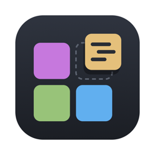

<h1 align="center">Tessera</h1>

A fast, native-feeling code editor for macOS, in the spirit of GitHub's Atom.

This repository hosts the downloads. Get the latest version from **[Releases](https://github.com/llanterme/tessera-releases/releases/latest)**.

## Install

1. Download the zip for your Mac:
   - **Apple Silicon** (M1 or later): `Tessera-…-mac-apple-silicon.zip`
   - **Intel**: `Tessera-…-mac-intel.zip`

   Not sure which you have? Apple menu → About This Mac → "Chip" (Apple M…) or "Processor" (Intel).
2. Unzip it and drag **Tessera** into your **Applications** folder.
3. Open it. The first time, macOS will warn that it can't verify the app, because this preview build isn't notarised by Apple yet:
   - Click **Done** (not "Move to Bin").
   - Open **System Settings → Privacy & Security**, scroll down, and click **Open Anyway** next to the message about Tessera.
   - Confirm with **Open Anyway** again.

   You only need to do this once. (Alternatively, in Terminal: `xattr -dr com.apple.quarantine /Applications/Tessera.app`.)

Requires macOS 13 (Ventura) or later.

## What's in it

- Tabs, split panes, a file tree with several project folders, and a fuzzy file finder (⌘P) and command palette (⌘⇧P)
- Syntax highlighting for about 140 languages, autocomplete and snippets
- Live previews for Markdown (with diagrams and maths), HTML, SVG, CSV, JSON and YAML (⌃⇧M)
- Format Document for 18 languages (⌥⇧F)
- Errors and warnings as you type for JSON, YAML, TOML and Python, with a Problems list (⌘⇧M)
- Git: changed lines in the gutter, a Git panel to stage, commit, switch branches and push (⌃9), with a warning before committing anything that looks like a key or token
- Spell check for prose and comments
- Image and PDF viewing
- Unsaved changes survive quitting and crashes
- A `tessera` command for Terminal (Tessera menu → Install Shell Command)
- Settings screen (⌘,), light and dark themes

## Feedback

Found a bug or have an idea? [Open an issue](https://github.com/llanterme/tessera-releases/issues).
